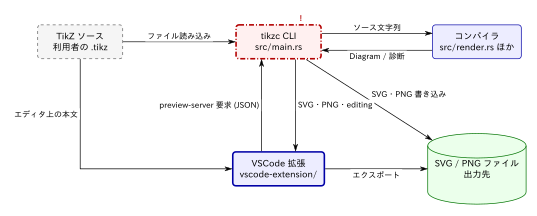

# oh-my-tikzc

[English](README.md)

Claude Code や Codex がコードから生成し，[tikzc](https://github.com/RyoNakagami/tikzc) で描画する，人が読むためのアーキテクチャドキュメント．

このスキルは，リポジトリをいくつかのアーキテクチャ上のパースペクティブ（視点）に分け，複雑な部品は掘り下げ，編集可能な TikZ 図を説明文やソース参照と並べて保管する．[oh-my-mermaid](https://github.com/oh-my-mermaid/oh-my-mermaid) のパースペクティブ方式を受け継いでいる．`.omm/` 形式のツリー，フィールド語彙，再帰的な掘り下げはそのままに，Mermaid の代わりに tikzc を，`omm` CLI の代わりに同梱のチェッカーを使う．



*このスキルで生成した tikzc 自身の全体アーキテクチャ（日本語）．tikzc v1.2.1 のスナップショットである[完全な例](examples/tikzc/.omtkc/index.md)も参照できる．*

詳しい解説は[はじめに：インストールと使い方](docs/JP/getting-started.md)と [oh-my-tikzc の仕組み](docs/JP/how-it-works.md)を参照．

## 得られるもの

- 全体像に加えて，データフロー，コマンドディスパッチ，外部連携など，役に立つパースペクティブ．
- 部品ごとのディレクトリからなる `.omtkc/` ツリー．全体像から詳細へは相対 Markdown リンクでたどれる．
- `.tikz` ソース，SVG / PNG の描画結果，ソースファイルに根拠をもつ説明文．
- 部品ごとの `meta.yaml`．ソースファイル，子要素，解析したコミット，描画状態を記録する．
- チェッカー `omtkc.py`．ツリーを検証し，前回の解析以降にソースが変わった部品を見つける．
- 人が書いたメモや，変更のないサブツリーを保持したままの更新．

これはスキルパッケージであり，レンダラーでもインストール型の CLI でもない．描画には別途インストールした tikzc の実行ファイルを使う．クラウドサービス，アカウント，アップロードコマンド，ホスト型ビューアはない．ドキュメントと描画結果はローカルのファイルに留まる．ただし，利用する AI ツール自体はそのツールのデータ・ネットワーク設定に従って動作する．

| oh-my-mermaid | oh-my-tikzc |
| --- | --- |
| `.omm/` と `meta.yaml` | `.omtkc/` と `meta.yaml`（[形式](skills/tikzc-architecture/references/format.md)） |
| `omm validate`，`omm refs` | `omtkc.py check` |
| `omm tree`，`omm status` | `omtkc.py tree` |
| `omm diff` | `git diff` と `omtkc.py stale` |
| `omm view` の Web ビューア | 相対リンクをたどる Markdown プレビュー |
| クラウドへの push / pull / share | なし |

## 前提条件

Rust 製の [tikzc CLI](https://github.com/RyoNakagami/tikzc#installation) と [uv](https://docs.astral.sh/uv/getting-started/installation/) をインストールし，両方が PATH 上にあることを確認する．

```sh
tikzc --version
uv --version
```

**tikzc 1.2.0 以上が必要である．** それより前のリリース（1.0 より前の TypeScript/TeX パイプラインを含む）はサポートしない．tikzc はフォントを内蔵したネイティブ描画エンジンであり，TeX ツールチェーンは不要である．スキルは実際にインストールされている CLI を確認し，未対応の構文があれば，別のレンダラーに切り替えずにそれを報告する．

uv は同梱のチェッカーを実行し，初回に唯一の依存（PyYAML）を取得する．tikzc，uv，その依存のインストールにはネットワークが必要な場合があるが，描画と検査には不要である．

uv がなくても，チェッカーは `python3`（3.10 以上）で動く．PyYAML がインストールされていればそれを使い，なければ `.omtkc/` が使う YAML サブセット用の組み込みパーサーを使う（[format.md](skills/tikzc-architecture/references/format.md#yaml-subset) を参照）．

## スキルのインストール

このリポジトリは，両ツール共通のプラグインマーケットプレイスである．唯一のプラグイン `oh-my-tikzc` に `tikzc-architecture` スキルが入っている．

**Claude Code** では次のコマンドでインストールする．

```sh
claude plugin marketplace add RyoNakagami/oh-my-tikzc
claude plugin install oh-my-tikzc@oh-my-tikzc
```

**Codex** では次のコマンドでインストールする．

```sh
codex plugin marketplace add RyoNakagami/oh-my-tikzc
codex plugin add oh-my-tikzc@oh-my-tikzc
```

インストール後は，ドキュメント化したいリポジトリで新しいセッションを開始する．更新するには，Claude Code では `claude plugin marketplace update oh-my-tikzc` のあと `claude plugin update oh-my-tikzc@oh-my-tikzc` を，Codex では `codex plugin marketplace upgrade oh-my-tikzc` を実行する．

どちらのツールも同じ `SKILL.md` を読む．`.codex-plugin/plugin.json` と `agents/openai.yaml` は Codex 用の UI メタデータを追加する．プロバイダー固有のツール名，フック，権限の上書きは不要である．

### 手動インストール

マーケットプレイスを使わない場合や，特定のプロジェクトだけに入れる場合は，`references/`，`assets/`，`scripts/`，`agents/` を含む `skills/tikzc-architecture/` を**ディレクトリごと**コピーする．個人スキルなら `~/.claude/skills/`（Claude Code）または `~/.agents/skills/`（Codex）へ，プロジェクト単位なら対象プロジェクトの `.claude/skills/` または `.agents/skills/` へコピーする．このリポジトリのルートで次のように実行する．

```sh
mkdir -p "$HOME/.claude/skills"
test ! -e "$HOME/.claude/skills/tikzc-architecture" && test ! -L "$HOME/.claude/skills/tikzc-architecture" && cp -R skills/tikzc-architecture "$HOME/.claude/skills/"
```

`test` による確認で，同名のインストールがすでにあると停止する．更新する場合は，先に既存のインストールと比較してバックアップを取ること．配置場所は公式の [Claude Code skills](https://code.claude.com/docs/en/skills) と [Codex skills](https://learn.chatgpt.com/docs/build-skills) のドキュメントに従っている．手動でインストールしたスキルは，以下の `oh-my-tikzc:` を付けずに呼び出す．

## 使い方

Claude Code では次のように依頼する．

```text
/oh-my-tikzc:tikzc-architecture このリポジトリのアーキテクチャを日本語で説明して．
```

Codex では次のように依頼する．

```text
$oh-my-tikzc:tikzc-architecture このリポジトリのアーキテクチャを日本語で説明して．
```

「tikzc でコードベースを図解して」と自然に頼んでもよい．必要に応じて範囲を絞る．

```text
tikzc-architecture で src/api/ のリクエストライフサイクルだけをドキュメント化して．
CLI モジュールの変更に合わせて，既存の .omtkc ドキュメントを更新して．
```

既定の出力先は，解析したリポジトリの `.omtkc/` である．

```text
.omtkc/
  config.yaml                  # スキーマと言語
  index.md                     # 入口
  overall-architecture/        # パースペクティブ
    description.md
    meta.yaml                  # sources，children，refs，解析コミット，描画状態
    diagram.tikz               # グループは図をもつ
    diagram.svg
    diagram.png
    compiler/                  # 図のノード 1 つにつき 1 ディレクトリ
      description.md
      meta.yaml
      diagram.tikz
      diagram.svg
      diagram.png
      text-engine/
        description.md         # リーフに図は不要
        meta.yaml
```

`.omtkc/index.md` を Markdown プレビューで開き，リンクをたどって詳細へ進む．各グループは SVG を埋め込み，子要素と編集可能なソースへリンクする．これは静的な文書ナビゲーションであり，SVG のノードをクリックして掘り下げることはできない．任意の tikzc VSCode 拡張を使うと，ソースのプレビューと編集ができる．

**`.omtkc/` はコードと一緒にコミットする．** そうすれば図の履歴は普通の `git diff` で追え，次回の更新では各部品の解析以降に何が変わったかを見つけられる．

スキルは変更した図をそれぞれコンパイル・描画し，画像を読むツールがあれば PNG を確認し，チェッカーを実行する．コンパイラや目視による検証ができなかった場合は，その旨を明示して報告する．アーキテクチャ上の結論は人によるレビューが必要である．図が説明するのは確認したコードであり，形式的に検証された仕様ではない．

### チェッカー

これらはスキルが自分で実行するが，直接実行することもできる．`<skill>` はインストールしたスキルのディレクトリである．たとえば `~/.claude/plugins/cache/oh-my-tikzc/oh-my-tikzc/<version>/skills/tikzc-architecture`（Codex では `~/.codex/plugins/cache/` 配下），手動インストールなら `~/.claude/skills/tikzc-architecture` となる．

```sh
uv run <skill>/scripts/omtkc.py check .omtkc   # 構造，リンク，sources，古い描画
uv run <skill>/scripts/omtkc.py tree .omtkc    # 階層と描画状態
uv run <skill>/scripts/omtkc.py stale .omtkc   # 解析以降にソースが変わった部品
```

uv がなければ `uv run` を `python3` に置き換える．

`check` は，図のノード ID が子ディレクトリと一致すること，ナビゲーションのリンクが解決すること，記録されたソースファイルが存在すること，refs が相互参照になっていること，各 SVG / PNG が現在の `.tikz` から描画されたことを検証する．矢印が正しいかどうかは判断できない．

## パッケージの開発

正式なスキルは [`skills/tikzc-architecture/`](skills/tikzc-architecture/SKILL.md) にある．[`examples/tikzc/.omtkc/`](examples/tikzc/.omtkc/index.md) は tikzc に対するその出力をスナップショットとして保存したものである．その `config.yaml` には元のリポジトリとコミットが記録され，ソースへのリンクはそのコミットへのパーマリンクになっている．

チェッカーのテストを実行する．

```sh
uv run --with pyyaml python -m unittest discover -s tests
```

PyYAML なしで `python3 -m unittest discover -s tests` を実行すると，組み込みの YAML パーサーを検査できる．その場合，PyYAML との比較テストはスキップされる．

テンプレートを検査し，プレビューを描画する．

```sh
tikzc check skills/tikzc-architecture/assets/architecture.tikz
tikzc skills/tikzc-architecture/assets/architecture.tikz -f both -o /tmp/oh-my-tikzc-preview/
```

テンプレートを変更したら PNG を確認する．スキルの変更は，コード変更後の更新も含めて実際のコードベースで試し，ソースの根拠，子へのリンク，メモの保持，診断の扱いを確認する．このパッケージは tikzc のバイナリを同梱せず，スキルを自動でインストールすることもない．

## ライセンスと帰属

[MIT](LICENSE)．アーキテクチャ解析のワークフローは oh-my-mermaid から取り入れたものであり，その著作権表示とライセンスを保持している．[NOTICE](NOTICE) を参照．tikzc は独自のライセンスをもつ別プロジェクトである．
