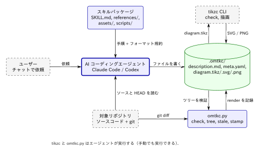
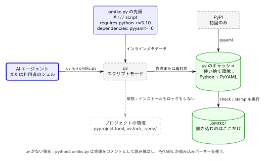
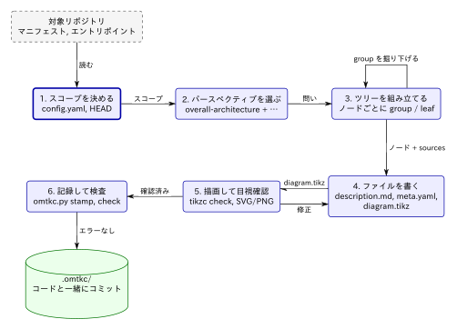
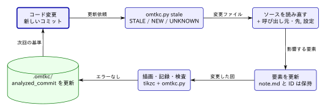

# oh-my-tikzc の仕組み

[English](../how-it-works.md) · [はじめに](getting-started.md)

oh-my-tikzc は，リポジトリをアーキテクチャ説明のツリーに変換する．ツリーの各階層では，編集可能な TikZ 図と説明文が対になり，ソースコードへのリンクが付く．このページでは，どの部品が何を担うか，エージェントがたどる手順，全体を結びつけるファイル形式，ドキュメントを最新に保つ方法を説明する．

## 構成要素

oh-my-tikzc は自分で実行するプログラムではない．**スキル**，つまり手順書といくつかの同梱ファイルの集まりであり，リポジトリのドキュメント化を依頼されたときに AI コーディングエージェントが読み込む．読む・書く・判断するのはエージェントであり，判断に任せるべきでない部分は 2 つの決定的なツールが担う．



*ソース：[figures/components.tikz](figures/components.tikz)*

| 部品 | 役割 |
| --- | --- |
| [`SKILL.md`](../../skills/tikzc-architecture/SKILL.md) | 手順書．スコープの決め方，検討すべきパースペクティブ，掘り下げる基準，更新の方法，検証すべき項目を定める． |
| [`references/format.md`](../../skills/tikzc-architecture/references/format.md) | `.omtkc/` のファイル形式（スキーマ `omtkc/1`）．レイアウト，`meta.yaml` のフィールド，チェッカーが強制する規約． |
| [`references/rendering.md`](../../skills/tikzc-architecture/references/rendering.md) | tikzc できれいに描画される TikZ の書き方と，結果の確認方法． |
| [`assets/architecture.tikz`](../../skills/tikzc-architecture/assets/architecture.tikz) | 共通の視覚語彙を定義したスターター図．すべての図はこれから始める． |
| [`scripts/omtkc.py`](../../skills/tikzc-architecture/scripts/omtkc.py) | チェッカー（`check`，`tree`，`stale`，`stamp`）．単一の Python ファイルで，依存は任意の PyYAML のみ． |
| [`agents/openai.yaml`](../../skills/tikzc-architecture/agents/openai.yaml) | Codex 用の UI メタデータ．Claude Code は無視する． |
| [`.claude-plugin/`](../../.claude-plugin/marketplace.json)，[`.codex-plugin/`](../../.codex-plugin/plugin.json) | プラグインとマーケットプレイスのマニフェスト．`claude plugin install` や `codex plugin add` でスキルをインストールできるようにする．実行時には使われない． |
| tikzc（別途インストール） | Rust 製のネイティブ TikZ レンダラー．TeX なしで `diagram.tikz` を SVG / PNG にコンパイルする． |

この役割分担は意図的なものである．アーキテクチャが*何であるか*はエージェントが決める．図が*コンパイルできるか*は tikzc が決める．ツリーが*整合しているか*（リンクが解決し，ID がディレクトリと一致し，画像がソースと一致するか）は `omtkc.py` が決める．どれも他の役割を代わりに果たすことはできない．

すべてはローカルで完結する．サーバー，アカウント，アップロードはなく，出力はコードの隣にコミットされる普通のファイルである．

### チェッカーがプロジェクトに触れずに動く仕組み

スキルが `uv init` を実行することはない．ドキュメント化するリポジトリに `pyproject.toml`，`uv.lock`，`.venv/` を追加することもない．スキルが使う uv のコマンドは `uv run <skill>/scripts/omtkc.py …` だけである．

これが成り立つのは，`omtkc.py` がファイル先頭の [PEP 723](https://peps.python.org/pep-0723/) インラインメタデータブロックで，自分の動作要件を宣言しているからである．

```python
# /// script
# requires-python = ">=3.10"
# dependencies = ["pyyaml>=6"]
# ///
```



*ソース：[figures/uv-run.tikz](figures/uv-run.tikz)*

このブロックをもつスクリプトを渡されると，`uv run` は次のように動く．

1. プロジェクトを探す代わりに，このブロックを読む．
2. 条件に合う Python と PyYAML を入れた使い捨ての環境を，uv のキャッシュ内に作る．パッケージのダウンロードは初回だけで，以後は再利用される．
3. その環境でスクリプトを実行する．

その結果，次のことが言える．

- **リポジトリには何も書き込まれない．** 例外は，エージェントが意図して作る `.omtkc/` のファイルだけである．変わるのは uv のキャッシュディレクトリだけである．
- **プロジェクトの環境は無視される．** 解析対象のリポジトリに `pyproject.toml` があっても，インラインメタデータをもつスクリプトを実行するとき，uv はその依存をインストールせず，ロックファイルも変更しない．チェッカーが利用者の環境を壊すことはなく，利用者の環境がチェッカーを壊すこともない．
- **ネットワークが必要なのは 1 回だけである．** 初回に PyYAML を取得するときに限られ，以後の検査や stamp はオフラインで動く．

uv がない場合，同じファイルを `python3 <skill>/scripts/omtkc.py …` で実行する．メタデータブロックは単なるコメントなので，Python は無視する．PyYAML を import できればそれを使う．できなければ，`.omtkc/` が使う YAML サブセット用の組み込みパーサーに切り替わる．そのため素の `python3`（3.10 以上）があれば足りる．

## 解析の流れ

新規スキャンでは，`SKILL.md` がエージェントに次の手順を求める．



*ソース：[figures/workflow.tikz](figures/workflow.tikz)*

### 1. スコープを決める

エージェントは，リポジトリの指示書，マニフェスト，エントリポイント，既存のアーキテクチャドキュメントを読む．`tikzc --version` と `uv --version` を確認し，スキーマ，依頼の言語，対象のソースディレクトリを書いた `config.yaml` を作る．また `git rev-parse --short HEAD` と作業ツリーがクリーンかどうかを記録する．このコミットが，のちに各要素の `analyzed_commit` になる．

### 2. 図ではなくパースペクティブを選ぶ

**パースペクティブ**とは，1 つの問いに答える最上位の視点である．リポジトリ全体の走査は必ず `overall-architecture` から始まる．追加のパースペクティブは，コードが*別の*有用な問いを支えるときだけ作る．

| パースペクティブ | 問い |
| --- | --- |
| `request-lifecycle` | リクエストはどう処理されるか |
| `data-flow` | データはどこで生まれ，変換され，永続化されるか |
| `command-surface` | CLI コマンドはどうディスパッチされるか |
| `dependency-map` | どのモジュールがどれに依存するか |
| `external-integrations` | どの外部システムに，どの境界を通じて接続するか |
| `state-transitions`，`pipeline`，`extension-points`，`route-page-map`，`storage` | … |

これらの名前は例にすぎない．より狭い問いには `preview-edit-flow` のような的確な名前を付ける．カタログを埋めるためだけの空の視点は作らない．

### 3. 説明のツリーを組み立てる

図の中の意味をもつノードは，それぞれ子ディレクトリになる．

1. エージェントはノードの背後にある実装を読み，`sources` を記録する．
2. そのノードの `description.md` と `meta.yaml` を書く．説明のないノードは作らない．
3. ノードの内部に説明すべき別々の責務があれば，それは独自の図をもつ**グループ**になり，1 段下で同じ手順を繰り返す．そうでなければ**リーフ**のままにする．

再帰するのは，図が読み手の役に立つ場合だけである．ディレクトリにサブディレクトリがあるという理由だけでは掘り下げない．薄いラッパー，外部システム，まとまった単位では止める．各図は 1 つの抽象度にとどめ，ノードは最大 12 個程度にする．図が混み合ったら，詳細を子や別のパースペクティブに移す．

包含ツリーは常に非循環である．一方，コード上の実際の循環は，ラベル付きのエッジとして描ける．複数のパースペクティブに現れる部品は，二重に入れ子にせず `refs` で相互に結ぶ．

重要なエッジはすべて実際のコードまでたどる．import だけでは実行時の呼び出しの証拠にならない．推測にはその旨を明記する．

### 4. ファイルを書く

各要素のディレクトリには，`description.md`（役割，境界，シンボル付きソースリンク，各関係の根拠）と `meta.yaml` を置く．グループには，スターターテンプレートから作った `diagram.tikz` も置く．任意ファイル（`context.md`，`constraint.md`，`concern.md`，`todo.md`，`note.md`）は，根拠があるときだけ書く．

### 5. 描画して目視確認する

新しい図や変更した図ごとに，エージェントは `tikzc check` を実行し，SVG と PNG を描画して，画像を読むツールで **PNG を実際に見る**．はみ出した文字，衝突するラベル，曖昧な交差，誤った矢印の向きを確認し，直して繰り返す．コンパイルの成功はレイアウトの品質について何も保証しないので，目視確認の代わりにはならない．画像ツールがなければ `visual: pending` と記録し，確認済みとは書かない．

### 6. 記録して検査する

`omtkc.py stamp` は，描画結果をグループの `meta.yaml` に書き込む．続いて `omtkc.py check` がツリー全体を検証し，エージェントはすべてのエラーを直してから報告する．

## `.omtkc/` 形式

`.omtkc/` は図の構造を映したディレクトリツリーであり，その構造自体がナビゲーションになる．

```text
.omtkc/
  config.yaml
  index.md                          → すべてのパースペクティブにリンク
  overall-architecture/             （グループ）
    description.md                  → ../index.md にリンク，diagram.svg を埋め込み，各子にリンク
    meta.yaml
    diagram.tikz  diagram.svg  diagram.png
    cli/                            （リーフ）
      description.md                → ../description.md にリンク
      meta.yaml
    compiler/                       （グループ，さらに掘り下げる）
      description.md  meta.yaml  diagram.tikz  diagram.svg  diagram.png
      render-engine/ …
```

### 図とディレクトリの対応規約

中心となる規則は，**意味をもつノードの TikZ ID が，その子ディレクトリの名前になる**ことである．[同梱の例](../../examples/tikzc/.omtkc/overall-architecture/diagram.tikz)では次のようになる．

```latex
\node[external]      (tikz-source)      ...   →  overall-architecture/tikz-source/
\node[entry,concern] (cli)              ...   →  overall-architecture/cli/
\node[block]         (compiler)         ...   →  overall-architecture/compiler/
\node[entry]         (vscode-extension) ...   →  overall-architecture/vscode-extension/
\node[store]         (output-files)     ...   →  overall-architecture/output-files/
```

`meta.yaml` にも同じ名前が並ぶ：`children: [tikz-source, cli, compiler, vscode-extension, output-files]`．

凡例，枠，注記などの装飾ノードは，ID を付けないか `_` で始まる ID にする．現在の要素の外にある部品を示すコンテキストノードは `_ctx-<name>` とする．どちらにもディレクトリは作らない．規則が機械的なので，「すべてのノードにページがあり，すべてのページにノードがある」ことをチェッカーが検証できる．

### `meta.yaml`

```yaml
kind: group                     # group | leaf
status: active                  # active | retired
sources:                        # この要素の根拠となるファイル
  - src/main.rs
  - src/render.rs#render        # 任意でシンボルを付けられる
children: [cli, compiler]       # 子ディレクトリと一致していること
refs: [data-flow/rust-renderer] # 別パースペクティブにある同じ部品（相互参照）
analyzed_commit: ef3a589        # この要素を最後に解析したときの HEAD
working_tree_dirty: false
render:                         # グループのみ．`omtkc.py stamp` が書く
  tikz_sha256: 37f4fa…
  tikzc_version: 1.2.1
  check: pass                   # pass | fail
  visual: inspected             # inspected | pending
```

仕組みの大部分を担うのは次の 2 つのフィールドである．

- **`analyzed_commit`** は，全体で 1 つではなく要素ごとに記録される．部分的な更新の後でも，各部品がいつコードと照合されたかを正確に示せる．これが差分更新を信頼できるものにしている．
- **`render.tikz_sha256`** は，現在の SVG / PNG を生成した `diagram.tikz` のハッシュである．`.tikz` を編集して再描画しなければハッシュが一致しなくなり，`check` がエラーを報告する．新しく checkout するとファイルの更新時刻はリセットされるので，更新時刻は使わない．

YAML は小さなサブセット（単純なマッピング，スカラーのリスト，コメント）に限定している．これにより，PyYAML の有無にかかわらずチェッカーが同じように読める．

### 視覚語彙

すべての図はテンプレートから同じオプションブロックをコピーする．そのため形状の意味はどの図でも同じであり，各スタイルは色に頼らずに区別できる．

| スタイル | 形状 | 意味 |
| --- | --- | --- |
| `block` | 角丸長方形 | 通常の内部部品 |
| `entry` | 太枠 | エントリポイント（CLI，HTTP ハンドラ，拡張機能の起動） |
| `store` | 円柱 | 永続ストレージ，書き出されるファイル |
| `external` | 破線枠 | リポジトリの外 |
| `concern` | 一点鎖線枠と `!` | `concern.md` に根拠のあるリスクがある |
| `context` | 灰色の点線枠 | この要素の外．子ではない |

すべての矢印には，関係ややり取りされるデータを示すラベルを付ける．

## チェッカーが検証すること

`omtkc.py check` は構造上の規約を強制する．

- `config.yaml` が存在し，`schema: omtkc/1` を宣言している．
- ディレクトリ名がケバブケースであり，各要素に `description.md` と `meta.yaml` がある．
- `meta.yaml` の `children` が実際の子ディレクトリと一致する．
- `diagram.tikz` の意味をもつノード ID ごとに子ディレクトリがあり，有効な子がすべて図に描かれている．
- 退役した子は図に描かれておらず，ノード ID は重複しない．
- `sources` のパスがリポジトリに存在する．
- `refs` の参照先が存在し，相互参照になっている．
- 相対 Markdown リンクがすべて解決する．各ページは親にリンクし，グループは `diagram.svg` を埋め込んですべての子にリンクする．
- グループに SVG と PNG があり，記録されたハッシュが現在の `diagram.tikz` と一致し，`check` が `pass` である．

このほか，ラベルのないエッジ，sources のない要素，片方向の refs，`visual: pending` には警告を出す．

チェッカーには，矢印が正しいかどうかは**判断できない**．アーキテクチャの正しさは，エージェントがエッジをコードまでたどることと，人によるレビューで担保する．チェッカーが保証するのは，欠落・破損・古さがないことだけである．

## 最新に保つ：更新サイクル

各要素がソースと解析時のコミットを記録しているので，更新のたびにリポジトリ全体を読み直す必要はない．



*ソース：[figures/refresh.tikz](figures/refresh.tikz)*

`omtkc.py stale` は，有効な要素ごとに `git diff <analyzed_commit> -- <sources>` を実行し，次の行を出力する．

| 行 | 意味 |
| --- | --- |
| `STALE <element>: <files>` | その要素の解析以降に，記録されたソースが変わった． |
| `NEW <file>` | `scope` 内で変更された，または未追跡のファイルのうち，どのリーフの `sources` にも含まれないもの． |
| `UNKNOWN <element>` | `analyzed_commit` がない，または差分を取れない．比較の基準がない． |

エージェントはそのソースに加えて，関係する呼び出し元・呼び出し先・設定を読み直し，どの要素，親の図，パースペクティブを変えるべきかを判断する．そのうえで次のように扱う．

- `note.md` などの人が書いた文章，安定した ID，影響のないサブツリーは保持する．
- `analyzed_commit` を進めるのは，変更されたソースを実際に照合した要素**だけ**である．文言の修正だけでは進めない．
- `NEW` のファイルは，既存のリーフに割り当てるか，新しいリーフを追加する．
- 削除された部品は `status: retired` で退役させ，人が書いた内容を黙って消さない．
- 再描画と stamp は変更した図だけに行い，変更していない図を再検証したとは主張しない．

グループの `sources` には，子の和集合ではなく，その図に描かれた関係を実装するファイルだけを書く．そうしないと，配下のどこかが変わるたびにグループが STALE と判定されてしまう．

## oh-my-mermaid との関係

oh-my-tikzc は [oh-my-mermaid](https://github.com/oh-my-mermaid/oh-my-mermaid) のパースペクティブ方式（`.omm/` 形式のツリー，7 つのフィールド語彙，再帰的な掘り下げ）を受け継いでいる．違いは次のとおりである．

| oh-my-mermaid | oh-my-tikzc |
| --- | --- |
| Mermaid の図 | tikzc で SVG / PNG に描画する TikZ．レイアウトを細かく制御できる |
| `omm` CLI（`validate`，`refs`，`tree`，`status`，`diff`） | 同梱スクリプト 1 つ `omtkc.py`（`check`，`tree`，`stale`，`stamp`）と `git diff` |
| `omm view` の Web ビューア | 任意の Markdown プレビューで相対リンクをたどる |
| クラウドへの push / pull / share | なし．ファイルはローカルに留まる |

## 制約

- 図が説明するのは確認したコードの範囲であり，形式的に検証された仕様ではない．
- tikzc がサポートするのは TikZ の実用的なサブセットであり，PGF/TikZ のすべてではない．未対応の構文は診断メッセージになり，別のレンダラーへの暗黙のフォールバックはない．
- SVG は静的である．移動は Markdown のリンクで行い，図のノードはクリックできない．
- スキルがソフトウェアのインストール，公開，Git の変更操作を行うことはない．`.omtkc/` をコミットするのは利用者自身である．
