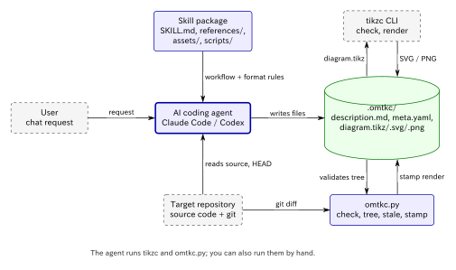
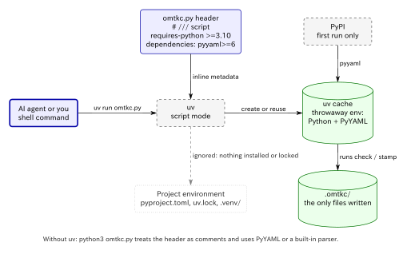
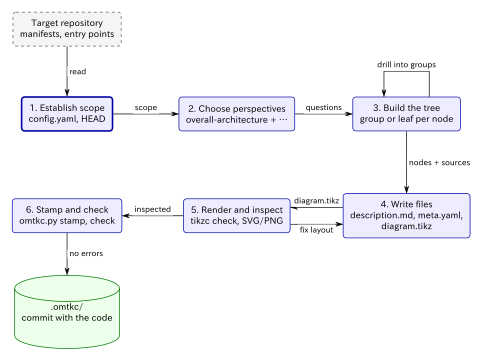
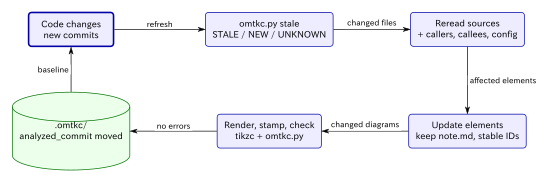

# How oh-my-tikzc works

[日本語](JP/how-it-works.md) · [Getting started](getting-started.md)

oh-my-tikzc turns a repository into a tree of architecture explanations. Each level pairs an editable TikZ diagram with prose and links back to the source code. This page explains which parts do what, the steps the agent follows, the file format that holds everything together, and how the documentation stays current.

## The moving parts

oh-my-tikzc is not a program you run. It is a **skill**: a set of instructions plus a few bundled files that an AI coding agent loads when you ask it to document a repository. The agent does the reading, writing, and judgment. Two deterministic tools handle the parts that should not be left to judgment.



*Source: [figures/components.tikz](figures/components.tikz)*

| Part | Role |
| --- | --- |
| [`SKILL.md`](../skills/tikzc-architecture/SKILL.md) | The workflow: how to scope, which perspectives to consider, when to drill down, how to refresh, and what to validate. |
| [`references/format.md`](../skills/tikzc-architecture/references/format.md) | The `.omtkc/` file format (schema `omtkc/1`): layout, `meta.yaml` fields, and the contracts the checker enforces. |
| [`references/rendering.md`](../skills/tikzc-architecture/references/rendering.md) | How to write TikZ that tikzc renders well, and how to inspect the result. |
| [`assets/architecture.tikz`](../skills/tikzc-architecture/assets/architecture.tikz) | The starter diagram with the shared visual vocabulary. Every diagram begins from it. |
| [`scripts/omtkc.py`](../skills/tikzc-architecture/scripts/omtkc.py) | The checker: `check`, `tree`, `stale`, `stamp`. A single Python file whose only dependency is PyYAML, which is optional. |
| [`agents/openai.yaml`](../skills/tikzc-architecture/agents/openai.yaml) | UI metadata for Codex. Claude Code ignores it. |
| [`.claude-plugin/`](../.claude-plugin/marketplace.json), [`.codex-plugin/`](../.codex-plugin/plugin.json) | Plugin and marketplace manifests, so that `claude plugin install` and `codex plugin add` can install the skill. Not used at run time. |
| tikzc (installed separately) | A Rust-native TikZ renderer. It compiles `diagram.tikz` into SVG and PNG with no TeX toolchain. |

This split is intentional. The agent decides what the architecture *is*. tikzc decides whether a diagram *compiles*. `omtkc.py` decides whether the tree is *consistent*: links resolve, IDs match directories, and images match their sources. None of the three can do another's job.

Everything stays local. There is no server, account, or upload step. The output is plain files committed next to your code.

### How the checker runs without touching your project

The skill never runs `uv init`, and it does not add a `pyproject.toml`, `uv.lock`, or `.venv/` to the repository being documented. Its only uv command is `uv run <skill>/scripts/omtkc.py …`.

That works because `omtkc.py` declares its own requirements in a [PEP 723](https://peps.python.org/pep-0723/) inline metadata block at the top of the file:

```python
# /// script
# requires-python = ">=3.10"
# dependencies = ["pyyaml>=6"]
# ///
```



*Source: [figures/uv-run.tikz](figures/uv-run.tikz)*

When `uv run` is given a script with this block, it:

1. Reads the block instead of looking for a project.
2. Creates a throwaway environment in uv's cache with a matching Python and PyYAML. The packages are downloaded once and reused on later runs.
3. Runs the script in that environment.

The consequences:

- **Nothing is written to your repository** except the `.omtkc/` files the agent creates on purpose. Only uv's cache directory changes.
- **Your project's environment is ignored.** Even if the analyzed repository has its own `pyproject.toml`, uv does not install its dependencies or modify its lock file when it runs a script with inline metadata. The checker can't break your environment, and your environment can't break the checker.
- **Network access is needed only once**, to fetch PyYAML on first use. Checking and stamping work offline after that.

Without uv, the same file runs as `python3 <skill>/scripts/omtkc.py …`. Python ignores the metadata block, which is just comments. If PyYAML is importable it is used. Otherwise the checker falls back to a built-in parser for the YAML subset that `.omtkc/` uses, so plain `python3` 3.10+ is enough.

## The analysis workflow

For a new scan, `SKILL.md` asks the agent to follow these steps:



*Source: [figures/workflow.tikz](figures/workflow.tikz)*

### 1. Establish scope

The agent reads the repository's instructions, manifests, entry points, and any existing architecture docs. It checks `tikzc --version` and `uv --version`. It creates `config.yaml` with the schema, the language of your request, and the source directories in scope. It records `git rev-parse --short HEAD` and whether the working tree is clean. That commit later becomes each element's `analyzed_commit`.

### 2. Choose perspectives, not diagrams

A **perspective** is a top-level view that answers one question. A repository-wide scan always starts with `overall-architecture`. Further perspectives are added only when the code supports a *different* useful question:

| Perspective | Question |
| --- | --- |
| `request-lifecycle` | How is a request handled? |
| `data-flow` | Where does data originate, change, and persist? |
| `command-surface` | How do CLI commands dispatch? |
| `dependency-map` | Which modules depend on others? |
| `external-integrations` | Which external systems are contacted, and through which boundary? |
| `state-transitions`, `pipeline`, `extension-points`, `route-page-map`, `storage` | … |

These names are suggestions. A narrower question gets a precise name, such as `preview-edit-flow`. Empty views are never created to fill out a catalog.

### 3. Build a tree of explanations

Each semantic node in a diagram becomes a child directory:

1. The agent reads the implementation behind the node and records its `sources`.
2. It writes `description.md` and `meta.yaml` for the node. Every node gets a description.
3. If the node has distinct internal responsibilities worth explaining, it becomes a **group** with its own diagram, and the process repeats one level down. Otherwise it stays a **leaf**.

The agent recurses only where a diagram helps the reader, not just because a directory has subdirectories. It stops at trivial wrappers, external systems, and cohesive units. Each diagram stays at one abstraction level with about twelve nodes at most. When a diagram gets crowded, detail moves into a child or another perspective.

The containment tree is always acyclic, while real cycles in the code can still appear as labeled edges. A component that appears in several perspectives is linked across them with `refs` instead of being nested twice.

Every important edge is traced to actual code. An import alone does not prove a runtime call. Inferences are labeled as such.

### 4. Write the files

Each element's directory gets a `description.md` (role, boundary, source links with symbols, evidence for each relationship) and a `meta.yaml`. A group also gets a `diagram.tikz` built from the starter template. Optional files (`context.md`, `constraint.md`, `concern.md`, `todo.md`, `note.md`) are written only when there is evidence for them.

### 5. Render and inspect

For every new or changed diagram, the agent runs `tikzc check`, renders SVG and PNG, and **looks at the PNG** with its image-reading tool. It checks for overflowing text, colliding labels, ambiguous crossings, and wrong arrow directions, then repairs and repeats. A successful compile says nothing about layout quality, so it doesn't count as inspection. If no image tool is available, the result is recorded as `visual: pending`, never as inspected.

### 6. Stamp and check

`omtkc.py stamp` writes the render result into the group's `meta.yaml`. `omtkc.py check` then validates the whole tree, and the agent fixes every error before reporting back.

## The `.omtkc/` format

`.omtkc/` is a directory tree that mirrors the diagrams. Its structure is the navigation.

```text
.omtkc/
  config.yaml
  index.md                          → links every perspective
  overall-architecture/             (group)
    description.md                  → links ../index.md, embeds diagram.svg, links each child
    meta.yaml
    diagram.tikz  diagram.svg  diagram.png
    cli/                            (leaf)
      description.md                → links ../description.md
      meta.yaml
    compiler/                       (group, drills down further)
      description.md  meta.yaml  diagram.tikz  diagram.svg  diagram.png
      render-engine/ …
```

### Diagram ↔ directory contract

The key rule: **a semantic node's TikZ ID is the name of its child directory.** In the [bundled example](../examples/tikzc/.omtkc/overall-architecture/diagram.tikz):

```latex
\node[external]      (tikz-source)      ...   →  overall-architecture/tikz-source/
\node[entry,concern] (cli)              ...   →  overall-architecture/cli/
\node[block]         (compiler)         ...   →  overall-architecture/compiler/
\node[entry]         (vscode-extension) ...   →  overall-architecture/vscode-extension/
\node[store]         (output-files)     ...   →  overall-architecture/output-files/
```

…and `meta.yaml` lists the same names: `children: [tikz-source, cli, compiler, vscode-extension, output-files]`.

Decorative nodes such as legends, frames, and notes have no ID or an ID starting with `_`. Context nodes, which show a component outside the current element, use `_ctx-<name>`. Neither kind gets a directory. Because the rule is mechanical, the checker can verify that every node has a page and every page has a node.

### `meta.yaml`

```yaml
kind: group                     # group | leaf
status: active                  # active | retired
sources:                        # files that justify this element
  - src/main.rs
  - src/render.rs#render        # optional symbol suffix
children: [cli, compiler]       # must equal the child directories
refs: [data-flow/rust-renderer] # same component in another perspective (mutual)
analyzed_commit: ef3a589        # HEAD when this element was last analyzed
working_tree_dirty: false
render:                         # groups only; written by `omtkc.py stamp`
  tikz_sha256: 37f4fa…
  tikzc_version: 1.2.1
  check: pass                   # pass | fail
  visual: inspected             # inspected | pending
```

Two fields carry most of the machinery:

- **`analyzed_commit`** is recorded per element, not globally. After a partial refresh, each component still says exactly when it was last checked against the code. This is what makes incremental updates trustworthy.
- **`render.tikz_sha256`** is a hash of the `diagram.tikz` that produced the current SVG/PNG. If someone edits the `.tikz` without re-rendering, the hash no longer matches and `check` reports an error. File modification times aren't used, because a fresh checkout resets them.

The YAML is restricted to a small subset (plain mappings, scalar lists, comments) so that the checker reads it the same way with or without PyYAML.

### Visual vocabulary

All diagrams copy one option block from the template, so a shape means the same thing everywhere, and each style can be told apart without color:

| Style | Shape | Meaning |
| --- | --- | --- |
| `block` | rounded rectangle | ordinary internal component |
| `entry` | thick border | entry point (CLI, HTTP handler, extension activation) |
| `store` | cylinder | persistent storage or written files |
| `external` | dashed border | outside the repository |
| `concern` | dash-dot border with `!` | has an evidenced risk in `concern.md` |
| `context` | dotted gray border | outside this element; not a child |

Every arrow carries a label that states the relationship or the data exchanged.

## What the checker verifies

`omtkc.py check` enforces the structural contracts:

- `config.yaml` exists and declares `schema: omtkc/1`.
- Directory names are kebab-case, and each element has `description.md` and `meta.yaml`.
- `children` in `meta.yaml` equals the actual child directories.
- Every semantic node ID in `diagram.tikz` has a child directory, and every active child is drawn.
- Retired children are not drawn, and node IDs are unique.
- Every `sources` path exists in the repository.
- `refs` targets exist and are mutual.
- Every relative Markdown link resolves. Each page links its parent, and groups embed `diagram.svg` and link every child.
- Groups have SVG and PNG files whose recorded hash matches the current `diagram.tikz`, and `check` is `pass`.

It also warns about unlabeled edges, elements with no sources, one-way refs, and `visual: pending`.

The checker **cannot** tell whether an arrow is true. Correctness of the architecture comes from the agent tracing edges to code and from your review. The checker only makes sure nothing is missing, broken, or out of date.

## Keeping it current: the refresh cycle

Because every element records its sources and the commit it was analyzed at, a refresh doesn't have to re-read the whole repository.



*Source: [figures/refresh.tikz](figures/refresh.tikz)*

`omtkc.py stale` runs `git diff <analyzed_commit> -- <sources>` for each active element and prints:

| Line | Meaning |
| --- | --- |
| `STALE <element>: <files>` | A recorded source changed since that element was analyzed. |
| `NEW <file>` | A changed or untracked file inside `scope` that no leaf lists in its `sources`. |
| `UNKNOWN <element>` | No `analyzed_commit`, or the commit can't be diffed. There is no baseline. |

The agent rereads those sources, plus the callers, callees, and configuration they touch, and decides which elements, parent diagrams, and perspectives need to change. It then:

- Preserves `note.md`, other human-written text, stable IDs, and unaffected subtrees.
- Moves `analyzed_commit` forward **only** on elements whose changed sources it actually checked. A wording fix alone doesn't move it.
- Assigns each `NEW` file to an existing leaf or adds a new one.
- Retires removed components (`status: retired`) instead of silently deleting human-authored material.
- Re-renders and stamps only the diagrams it changed, and never claims that unchanged diagrams were revalidated.

A group's `sources` lists only the files that implement the relationships in its diagram, not the union of its children. Otherwise every change anywhere below would flag the group as stale.

## Relationship to oh-my-mermaid

oh-my-tikzc adapts the perspective-based method of [oh-my-mermaid](https://github.com/oh-my-mermaid/oh-my-mermaid): the `.omm/`-style tree, the seven-field vocabulary, and recursive drill-down. The differences:

| oh-my-mermaid | oh-my-tikzc |
| --- | --- |
| Mermaid diagrams | TikZ rendered by tikzc to SVG/PNG, with full control over layout |
| `omm` CLI (`validate`, `refs`, `tree`, `status`, `diff`) | One bundled script, `omtkc.py` (`check`, `tree`, `stale`, `stamp`), plus `git diff` |
| `omm view` web viewer | Any Markdown preview, following relative links |
| Cloud push / pull / share | Not included; files stay local |

## Limits

- Diagrams explain the code that was inspected. They are not a formally verified specification.
- tikzc supports a practical subset of TikZ, not all of PGF/TikZ. Unsupported syntax produces a diagnostic, and there is no silent fallback to another renderer.
- The SVGs are static. Navigation happens through Markdown links, not by clicking diagram nodes.
- The skill never installs software, publishes anything, or runs Git mutations. Committing `.omtkc/` is up to you.
