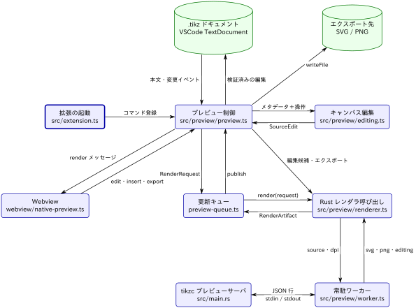

[← 目次](../index.md)

# データフロー（VSCode プレビューと編集）

種別：グループ．解析コミット `32ac110`．

編集可能な図のソース：[diagram.tikz](diagram.tikz)

この視点は「VSCode 上で `.tikz` を編集したとき，ソース・SVG / PNG・編集メタデータがどこから来て，どう変わり，どこへ書かれるか」に答える．全体図の [VSCode 拡張](../overall-architecture/vscode-extension/description.md) を分解したものである．

流れは 3 つある．

1. **プレビュー**：ドキュメントの変更 → プレビュー制御が `RenderRequest` を作る → 更新キューがデバウンスして最新の 1 件だけをコンパイル → Rust レンダラ呼び出し → 常駐ワーカー → `tikzc --preview-server` → 結果を Webview へ `render` メッセージで送る．
2. **キャンバス編集**：Webview の操作（`edit`，`insert`，`move-object` など）→ プレビュー制御がキャンバス編集モジュールで `SourceEdit` を計算 → 編集後のソースを **先にコンパイルして検証** → 成功したときだけ `WorkspaceEdit` でドキュメントへ反映する（`applyCanvasEdit`）．
3. **エクスポート**：形式と保存先を選ばせ，Rust レンダラ呼び出しで得た SVG / PNG を `writeFile` で書く（`exportAs`）．

## 関係の根拠

- **拡張の起動 → プレビュー制御**：`activate()` が `activateNativePreview(context)` を呼び，`tikzc.showPreview` と `tikzc.export` を登録する（[extension.ts](https://github.com/RyoNakagami/tikzc/blob/ef3a589541731a9c7098921c25f4770d86ac5d37/vscode-extension/src/extension.ts)，[preview.ts](https://github.com/RyoNakagami/tikzc/blob/ef3a589541731a9c7098921c25f4770d86ac5d37/vscode-extension/src/preview/preview.ts)）．
- **.tikz ドキュメント ⇄ プレビュー制御**：`onDidChangeTextDocument` → `refresh()`．反映は `vscode.workspace.applyEdit(change)`．
- **プレビュー制御 ⇄ 更新キュー**：`queue.update(request(document), delay)`，結果は `publish` コールバック．
- **更新キュー ⇄ Rust レンダラ呼び出し**：キューの `compile` が `renderer.render(value)` を呼ぶ．
- **プレビュー制御 → Rust レンダラ呼び出し（直接）**：キャンバス編集の候補とエクスポートはキューを通らず `renderer.render(...)` を直接呼ぶ．
- **Rust レンダラ呼び出し ⇄ 常駐ワーカー**：`worker.request(source, request.dpi)`（[renderer.ts](https://github.com/RyoNakagami/tikzc/blob/ef3a589541731a9c7098921c25f4770d86ac5d37/vscode-extension/src/preview/renderer.ts)）．
- **常駐ワーカー ⇄ プレビューサーバ**：`spawn(binary, ["--preview-server"])` と JSON 行（[worker.ts](https://github.com/RyoNakagami/tikzc/blob/ef3a589541731a9c7098921c25f4770d86ac5d37/vscode-extension/src/preview/worker.ts)，[src/main.rs](https://github.com/RyoNakagami/tikzc/blob/ef3a589541731a9c7098921c25f4770d86ac5d37/src/main.rs)）．
- **プレビュー制御 ⇄ Webview**：`panel.webview.postMessage({type:"render", ...})` と `onDidReceiveMessage`（[webview/native-preview.ts](https://github.com/RyoNakagami/tikzc/blob/ef3a589541731a9c7098921c25f4770d86ac5d37/vscode-extension/webview/native-preview.ts)）．
- **プレビュー制御 ⇄ キャンバス編集**：`moveObject`，`movePathPoint`，`insertDrawing`，`editNode` などが `SourceEdit` を返す（[editing.ts](https://github.com/RyoNakagami/tikzc/blob/ef3a589541731a9c7098921c25f4770d86ac5d37/vscode-extension/src/preview/editing.ts)）．
- **プレビュー制御 → エクスポート先**：`vscode.workspace.fs.writeFile(target, ...)`．

時間・サイズの上限などの不変条件は [constraint.md](constraint.md) にまとめた．

## 子要素

- [.tikz ドキュメント](tikz-document/description.md)（`tikz-document`）
- [拡張の起動](extension-activation/description.md)（`extension-activation`）
- [プレビュー制御](preview-controller/description.md)（`preview-controller`）
- [更新キュー](preview-queue/description.md)（`preview-queue`）
- [Rust レンダラ呼び出し](rust-renderer/description.md)（`rust-renderer`）
- [常駐ワーカー](native-worker/description.md)（`native-worker`）
- [tikzc プレビューサーバ](tikzc-preview-server/description.md)（`tikzc-preview-server`）
- [Webview](webview/description.md)（`webview`）
- [キャンバス編集](canvas-editing/description.md)（`canvas-editing`）
- [エクスポート先](export-files/description.md)（`export-files`）

## ソース

- [vscode-extension/src/](https://github.com/RyoNakagami/tikzc/tree/ef3a589541731a9c7098921c25f4770d86ac5d37/vscode-extension/src)
- [vscode-extension/webview/](https://github.com/RyoNakagami/tikzc/tree/ef3a589541731a9c7098921c25f4770d86ac5d37/vscode-extension/webview)
- [src/main.rs — `preview_server`](https://github.com/RyoNakagami/tikzc/blob/ef3a589541731a9c7098921c25f4770d86ac5d37/src/main.rs)

## 補足

- [不変条件](constraint.md)
