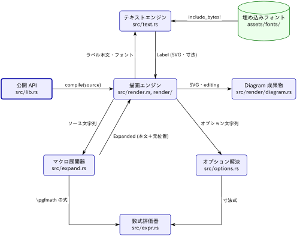

[← 全体アーキテクチャ](../description.md)

# コンパイラ（Rust ライブラリ）

種別：グループ．解析コミット `32ac110`．

編集可能な図のソース：[diagram.tikz](diagram.tikz)

`tikzc` クレートのライブラリ部分．TikZ ソース文字列を受け取り，SVG 文字列・寸法・ノード表・編集用メタデータからなる `Diagram` を返す．失敗時は行・列付きの `Diagnostic` を返し，代替レンダラへは落ちない（[docs/ARCHITRECTURE.md](https://github.com/RyoNakagami/tikzc/blob/ef3a589541731a9c7098921c25f4770d86ac5d37/docs/ARCHITRECTURE.md) Article 4）．

処理の順序は次のとおり（[src/render.rs](https://github.com/RyoNakagami/tikzc/blob/ef3a589541731a9c7098921c25f4770d86ac5d37/src/render.rs) の `compile_with_text`）．

1. 公開 API が `TextEngine` を用意して `compile_with_text` を呼ぶ．
2. マクロ展開器が `\foreach`，`\newcommand`，`\pgfmathsetmacro` などを展開し，各バイトが元ソースのどこから来たかを保持した `Expanded` を返す（`crate::expand::expand(source)?`）．
3. 描画エンジンが `#|` ヘッダを読み，展開後の本文をコマンド単位で処理して SVG 要素を集める．オプション文字列はオプション解決，ラベルはテキストエンジンに渡す．
4. 最後に要素をレイヤー順に並べて SVG を組み立て，`Diagram` を返す．PNG は必要なときに `Diagram::png` が作る．

## 関係の根拠

- **描画エンジン → マクロ展開器**：`compile_with_text` 冒頭の `crate::expand::expand(source)?`．
- **描画エンジン → オプション解決**：`e.state.styles.resolve(...)` が render.rs・nodes.rs・paths.rs・coordinates.rs から呼ばれる．
- **描画エンジン ⇄ テキストエンジン**：`self.text.layout(...)`（[render/nodes.rs](https://github.com/RyoNakagami/tikzc/blob/ef3a589541731a9c7098921c25f4770d86ac5d37/src/render/nodes.rs)）が `Arc<Label>`（SVG と寸法）を返す．
- **埋め込みフォント → テキストエンジン**：`TextEngine::new()` が `include_bytes!("../assets/fonts/…")` で 6 書体を取り込む（[src/text.rs](https://github.com/RyoNakagami/tikzc/blob/ef3a589541731a9c7098921c25f4770d86ac5d37/src/text.rs)）．
- **マクロ展開器・オプション解決 → 数式評価器**：`crate::expr::eval` / `eval_value` を [src/expand.rs](https://github.com/RyoNakagami/tikzc/blob/ef3a589541731a9c7098921c25f4770d86ac5d37/src/expand.rs) と [src/options.rs](https://github.com/RyoNakagami/tikzc/blob/ef3a589541731a9c7098921c25f4770d86ac5d37/src/options.rs) の `length` が呼ぶ．テキストエンジンも空白幅の計算で呼ぶ（図では省略）．
- **オプション解決 → 描画エンジン（矢印指定の判定）**：1.2.1 から `Styles::resolve` が `crate::arrows::is_spec` を呼んで `-Stealth` などを矢印指定と判定する（[src/options.rs](https://github.com/RyoNakagami/tikzc/blob/ef3a589541731a9c7098921c25f4770d86ac5d37/src/options.rs)，[src/arrows.rs](https://github.com/RyoNakagami/tikzc/blob/ef3a589541731a9c7098921c25f4770d86ac5d37/src/arrows.rs)）．補助的な判定関数の呼び出しなので図では省略した．
- **描画エンジン → Diagram 成果物**：`Ok(Diagram { svg, width, height, nodes, labels, editing, ... })`．

## 子要素

- [公開 API](public-api/description.md)（`public-api`）
- [描画エンジン](render-engine/description.md)（`render-engine`）
- [Diagram 成果物](diagram-artifact/description.md)（`diagram-artifact`）
- [テキストエンジン](text-engine/description.md)（`text-engine`）
- [埋め込みフォント](embedded-fonts/description.md)（`embedded-fonts`）
- [マクロ展開器](macro-expander/description.md)（`macro-expander`）
- [オプション解決](option-resolver/description.md)（`option-resolver`）
- [数式評価器](math-evaluator/description.md)（`math-evaluator`）

## ソース

- [src/lib.rs](https://github.com/RyoNakagami/tikzc/blob/ef3a589541731a9c7098921c25f4770d86ac5d37/src/lib.rs)
- [src/render.rs](https://github.com/RyoNakagami/tikzc/blob/ef3a589541731a9c7098921c25f4770d86ac5d37/src/render.rs)
- [src/render/](https://github.com/RyoNakagami/tikzc/tree/ef3a589541731a9c7098921c25f4770d86ac5d37/src/render)
- [src/expand.rs](https://github.com/RyoNakagami/tikzc/blob/ef3a589541731a9c7098921c25f4770d86ac5d37/src/expand.rs)
- [src/expand/](https://github.com/RyoNakagami/tikzc/tree/ef3a589541731a9c7098921c25f4770d86ac5d37/src/expand)
- [src/expr.rs](https://github.com/RyoNakagami/tikzc/blob/ef3a589541731a9c7098921c25f4770d86ac5d37/src/expr.rs)
- [src/options.rs](https://github.com/RyoNakagami/tikzc/blob/ef3a589541731a9c7098921c25f4770d86ac5d37/src/options.rs)
- [src/syntax.rs](https://github.com/RyoNakagami/tikzc/blob/ef3a589541731a9c7098921c25f4770d86ac5d37/src/syntax.rs)
- [src/text.rs](https://github.com/RyoNakagami/tikzc/blob/ef3a589541731a9c7098921c25f4770d86ac5d37/src/text.rs)
- [src/transform.rs](https://github.com/RyoNakagami/tikzc/blob/ef3a589541731a9c7098921c25f4770d86ac5d37/src/transform.rs)
- [src/curve.rs](https://github.com/RyoNakagami/tikzc/blob/ef3a589541731a9c7098921c25f4770d86ac5d37/src/curve.rs)
- [src/arrows.rs](https://github.com/RyoNakagami/tikzc/blob/ef3a589541731a9c7098921c25f4770d86ac5d37/src/arrows.rs)
- [assets/fonts/](https://github.com/RyoNakagami/tikzc/tree/ef3a589541731a9c7098921c25f4770d86ac5d37/assets/fonts)
