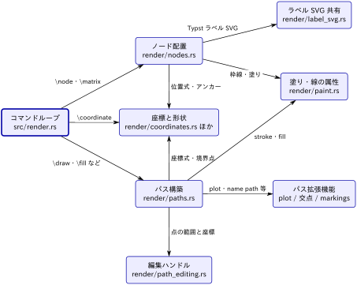

[← コンパイラ（Rust ライブラリ）](../description.md)

# 描画エンジン

種別：グループ．解析コミット `32ac110`．

編集可能な図のソース：[diagram.tikz](diagram.tikz)

展開後の本文をコマンド単位で解釈し，SVG 要素と編集メタデータを作る部分．状態は `Engine` 構造体（[src/render.rs](https://github.com/RyoNakagami/tikzc/blob/ef3a589541731a9c7098921c25f4770d86ac5d37/src/render.rs)）にまとまり，`render/` 以下の各モジュールが `impl Engine` を分担している．

この図は「どのコマンドがどのモジュールで処理されるか」に答える．`render.rs` のディスパッチが入口で，ノードとパスの 2 系統に分かれ，座標・形状と塗り属性を共有する．

## 関係の根拠

- **コマンドループ → ノード配置**：`"node"` → `e.parse_node` / `e.place_node`，`"matrix"` → `e.matrix`．
- **コマンドループ → 座標と形状**：`"coordinate"` → `e.read_point`．
- **コマンドループ → パス構築**：`"draw" | "path" | "fill" | "filldraw" | "clip" | "shade" | "shadedraw"` → `e.path(&mut cur, cmd)`．
- **ノード配置 / パス構築 → 座標と形状**：`read_point`，`Node::anchor`，`Node::border`（[render/nodes.rs](https://github.com/RyoNakagami/tikzc/blob/ef3a589541731a9c7098921c25f4770d86ac5d37/src/render/nodes.rs)，[render/paths.rs](https://github.com/RyoNakagami/tikzc/blob/ef3a589541731a9c7098921c25f4770d86ac5d37/src/render/paths.rs)）．
- **ノード配置 → ラベル SVG 共有**：`self.glyphs.embed(&p.label.svg, id)`（nodes.rs）．
- **ノード配置 / パス構築 → 塗り・線の属性**：`self.paint(...)`，`line_width`，`opacity_attribute`，二重線の `double_strokes`（1.2.1 で両者の共通処理になった）．
- **パス構築 → パス拡張機能**：`self.plot_function`，`self.plot_marks`，`self.name_intersections`，`self.markings`，`self.shading`（paths.rs）．
- **パス構築 → 編集ハンドル**：`self.path_handle(...)`（paths.rs）．

図に描いていない関係：パス上のノード（`node` を path 中に書いたもの）はパス構築が `place_path_node` でノード配置に渡す．ラベルの組版はノード配置がテキストエンジン（[../text-engine](../text-engine/description.md)）に依頼する．

## 子要素

- [コマンドループ](command-loop/description.md)（`command-loop`）
- [ノード配置](nodes/description.md)（`nodes`）
- [座標と形状](geometry/description.md)（`geometry`）
- [パス構築](paths/description.md)（`paths`）
- [ラベル SVG 共有](label-svg/description.md)（`label-svg`）
- [塗り・線の属性](paint/description.md)（`paint`）
- [パス拡張機能](path-features/description.md)（`path-features`）
- [編集ハンドル](path-editing/description.md)（`path-editing`）

## ソース

- [src/render.rs](https://github.com/RyoNakagami/tikzc/blob/ef3a589541731a9c7098921c25f4770d86ac5d37/src/render.rs)
- [src/render/](https://github.com/RyoNakagami/tikzc/tree/ef3a589541731a9c7098921c25f4770d86ac5d37/src/render)
- [src/transform.rs](https://github.com/RyoNakagami/tikzc/blob/ef3a589541731a9c7098921c25f4770d86ac5d37/src/transform.rs)
- [src/curve.rs](https://github.com/RyoNakagami/tikzc/blob/ef3a589541731a9c7098921c25f4770d86ac5d37/src/curve.rs)
- [src/arrows.rs](https://github.com/RyoNakagami/tikzc/blob/ef3a589541731a9c7098921c25f4770d86ac5d37/src/arrows.rs)
