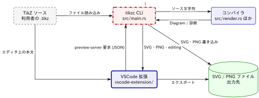

[← 目次](../index.md)

# 全体アーキテクチャ

種別：グループ．解析コミット `ef3a589`．

編集可能な図のソース：[diagram.tikz](diagram.tikz)

tikzc は「TikZ のサブセットを TeX なしで SVG / PNG に変換する」ための Rust 製コンパイラと，それを呼び出す VSCode 拡張の 2 部構成である（[README.md](https://github.com/RyoNakagami/tikzc/blob/ef3a589541731a9c7098921c25f4770d86ac5d37/README.md) の Repository layout，[docs/REPOSITORY_STRUCTURE.md](https://github.com/RyoNakagami/tikzc/blob/ef3a589541731a9c7098921c25f4770d86ac5d37/docs/REPOSITORY_STRUCTURE.md)）．
この視点は「どの部品があり，どこからどこへ何が渡るか」に答える．

境界は次のとおり．

- リポジトリ内：Rust クレート（`src/`，`Cargo.toml`）と VSCode 拡張（`vscode-extension/`）．
- リポジトリ外：利用者が書く `.tikz` ファイルと，出力された SVG / PNG ファイル．
- 開発用の `tests/`，`devtools/`，`.github/`，`notebook/` は実行時の構成要素ではないため図から除いた．

## 関係の根拠

- **TikZ ソース → CLI**：`run()` が `std::fs::read_to_string(&input)` で読む（[src/main.rs](https://github.com/RyoNakagami/tikzc/blob/ef3a589541731a9c7098921c25f4770d86ac5d37/src/main.rs)）．
- **CLI ⇄ コンパイラ**：`tikzc::compile(&source)` が `Diagram` か `Diagnostic`（行・列付き）を返す．CLI はそれを `file:line:column: message` として終了コード 3 で表示する（[src/main.rs](https://github.com/RyoNakagami/tikzc/blob/ef3a589541731a9c7098921c25f4770d86ac5d37/src/main.rs)，[src/lib.rs](https://github.com/RyoNakagami/tikzc/blob/ef3a589541731a9c7098921c25f4770d86ac5d37/src/lib.rs)）．
- **CLI → SVG / PNG ファイル**：`diagram.svg` と `diagram.png(dpi)` を `std::fs::write` で書く．PNG 変換は書き込み前にすべて済ませる（コメント「Finish all conversions before writing any output.」）．
- **VSCode 拡張 ⇄ CLI**：拡張は `tikzc --preview-server` を子プロセスとして起動し，標準入出力の JSON 行で `{source, dpi}` を送り `{svg, png, editing}` を受け取る（[src/main.rs](https://github.com/RyoNakagami/tikzc/blob/ef3a589541731a9c7098921c25f4770d86ac5d37/src/main.rs) の `preview_server`，[vscode-extension/src/preview/worker.ts](https://github.com/RyoNakagami/tikzc/blob/ef3a589541731a9c7098921c25f4770d86ac5d37/vscode-extension/src/preview/worker.ts)）．
- **TikZ ソース → VSCode 拡張**：拡張はファイルではなくエディタ上の `TextDocument` の本文を読む（`doc.getText()`，[preview.ts](https://github.com/RyoNakagami/tikzc/blob/ef3a589541731a9c7098921c25f4770d86ac5d37/vscode-extension/src/preview/preview.ts)）．
- **VSCode 拡張 → SVG / PNG ファイル**：エクスポートは `vscode.workspace.fs.writeFile` で書く．

設計原則（単一レンダラ，完全ローカル，黙った劣化をしない）は [context.md](context.md) に，コードが守っている不変条件は [constraint.md](constraint.md) にまとめた．

## 子要素

- [TikZ ソース](tikz-source/description.md)（`tikz-source`）
- [tikzc CLI](cli/description.md)（`cli`）
- [コンパイラ（Rust ライブラリ）](compiler/description.md)（`compiler`）
- [VSCode 拡張](vscode-extension/description.md)（`vscode-extension`）
- [SVG / PNG ファイル](output-files/description.md)（`output-files`）

## ソース

- [src/main.rs](https://github.com/RyoNakagami/tikzc/blob/ef3a589541731a9c7098921c25f4770d86ac5d37/src/main.rs)
- [src/lib.rs](https://github.com/RyoNakagami/tikzc/blob/ef3a589541731a9c7098921c25f4770d86ac5d37/src/lib.rs)
- [src/render.rs](https://github.com/RyoNakagami/tikzc/blob/ef3a589541731a9c7098921c25f4770d86ac5d37/src/render.rs)
- [vscode-extension/src/extension.ts](https://github.com/RyoNakagami/tikzc/blob/ef3a589541731a9c7098921c25f4770d86ac5d37/vscode-extension/src/extension.ts)
- [Cargo.toml](https://github.com/RyoNakagami/tikzc/blob/ef3a589541731a9c7098921c25f4770d86ac5d37/Cargo.toml)

## 補足

- [設計の背景](context.md)
- [不変条件](constraint.md)
